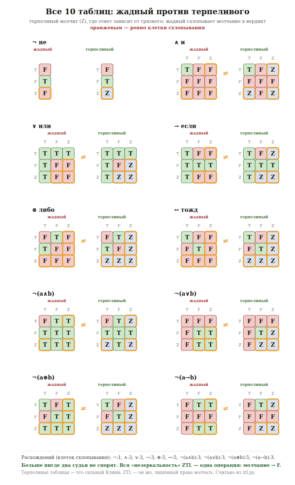

# Глава 9. Два судьи, и они спорят

*Нужно понимать функцию: правило, которое из входа делает выход.*

---

## Обещание, которое я давал

В пятой главе правило звучало так: истинно, если истинно при каждом раскладе
грязного. И тут же стояла оговорка, на которую легко было не обратить
внимания: важно, **к чему** ты это правило применяешь — к целой формуле или к
каждому куску по отдельности.

Оговорка оказалась не мелочью. Из неё выходят два разных судьи.

## Считать по шагам или целиком

**Жадный считает ПО ШАГАМ.** Сперва самая внутренняя связка, потом наружу. На
каждом шаге спрашивает «при каждом ли раскладе?», получает готовое «да» или
«нет» — и дальше работает уже с ним.

**Терпеливый берёт формулу ЦЕЛИКОМ.** Перебирает расклады один раз, для всего
утверждения сразу — с одним значением каждой строчки на все её упоминания, — и
смотрит, во всех ли оно верно.

Кажется, что разницы быть не должно. Она есть:

    при грязном p             по шагам      целиком
    ¬(p и не-p)                  верно        верно
    p или не-p                   НЕВЕРНО      верно
    если p, то p                 НЕВЕРНО      верно

Вторая строка — вот она, разница. По шагам судья читает каждое упоминание p
отдельно: два упоминания грязного — два чтения (третья глава). «Не-p» он
считает само по себе и получает «нет». Связать его с первым p ему не на чем:
никто не обещал, что хозяин не поменял p в промежутке.

Терпеливый связывает: в каждом его раскладе у p **одно** значение на оба
упоминания, и в каждом одна из половин истинна. То есть он **молча
предполагает, что грязное стоит на месте**. Для очищенного это правда. Для
грязного — допущение.

## И теперь главное: они спорят

Тут я обязан сказать вещь, которую в первой версии этой главы написал неверно, и
поправить себя вслух.

Я написал тогда: «они никогда не спорят». Это **неправда**, и опровергается она
таблицей тремя абзацами выше — той самой, что я сам же и напечатал.

Промерили: на двадцати трёх тысячах случаев двое расходятся в тысяче шестистах.
И расхождения бывают **двух разных родов**.

**ОТЛОЖЕННОЕ «ДА».** Жадный говорит «нет», терпеливый — «верно». Тысяча
двести тридцать случаев. В первых редакциях этой главы они назывались
**потерями**: мол, ответ один при любом исходе, а жадный этого не видит. Слово
было неточным, и вот почему.

Терпеливый прав про то, что будет **после очистки**: проверят p — оно станет
одним на все упоминания, и ответ выйдет «да» при любом исходе. Жадный в этих
случаях прав про то, что есть **сейчас**: пока p грязное, его упоминания —
разные чтения, и при неудачной паре ответ «нет». Это не один вопрос с двумя ответами, а два разных
вопроса: «что верно сейчас» и «что станет верно, когда очистим».

И это не толкование задним числом, а счёт. Если читать каждое упоминание
грязного отдельно и требовать истины при каждом чтении, жадный не теряет **ни
одного** «да» — ноль на всём переборе (числа в конце главы). Все прежние
«потери» — ровно те случаи, где «да» даёт только допущение, что хозяин ничего
не поменял.

Отказ тут не напрасный. Он значит «пока не очистишь — не заработано». Очистишь —
получишь своё «да».

Только не переворачивай это в похвалу жадному целиком. Честен про «сейчас» его
**отказ**: ни одного «нет» там, где грязное чтение дало бы «да». А его «да» про
«сейчас» честно не всегда — дальше будет видно где.

**ПОДАРОК.** Жадный говорит **«да»**, а терпеливый — «нет». Четыреста случаев.

Вот это уже серьёзно. Здесь машина, обещавшая не давать в кредит, **даёт его**.

И грязное чтение его не оправдывает. Очистка — частный случай чтения: все
упоминания совпали. Раз при очистке выходит «нет», то и среди чтений есть такое,
где выходит «нет». Подарок остаётся подарком.

## Куда смотреть, чтобы увидеть утечку

Есть и третий случай, помимо отложенного «да» и подарка, и он самый короткий:
**двойное отрицание**.

    ¬ от грязного        даёт «нет»
    ¬ от этого «нет»     даёт «ДА»

То есть «неверно, что неверно p» выходит **истинным** — при том, что p никто не
очищал.

А теперь проверь p. Если окажется, что p ложно — «неверно, что неверно p» тоже
станет ложным. Заработанная истина **сгорает**.

Это и есть кредит, выданный машиной, которая обещала его не выдавать. Не
оговорка и не редкость: одна из самых коротких формул языка.

Строго говоря, это не «подарок» в смысле предыдущего раздела — там терпеливый
говорил «нет», а тут он молчит: при одном исходе выходит «да», при другом «нет».
Но результат тот же: жадный сказал «да» о грязном, и проверка это отменит.

И вот число, которое я обязан назвать, потому что оно против нас. Если считать
подарком **всякий** жадный «да», который проверка может отменить, — таких мест
**больше, чем отложенных «да»**. Не «реже и дороже», как я написал строчкой выше в первой
редакции, а чаще и дороже.

## Почему мы это не чиним

Первое желание — заклеить дырку: сделать так, чтобы двойное отрицание не давало
истины. Но за него держится вся остальная конструкция, и в четырнадцатой главе
мы увидим, что именно эта клетка отличает нашу логику от соседей.

Значит выбор был сделан, и сделан открыто: **мы приняли один подарок ради того,
чтобы всё остальное работало.** Не «у нас нет кредита» — а «кредит у нас ровно
один, вот он, вот его цена».

Книга, которая скрыла бы эту клетку, была бы книгой не про то, про что она.

## Кто из двоих настоящий

Судья, который считает по-настоящему, — **жадный**. Все таблицы пятой главы, весь
прайс-лист седьмой, все примеры — это он.

Терпеливый — не второй механизм, а **способ посмотреть на ту же формулу из
будущего**: что будет верно, когда грязное очистят, при любом исходе очистки.
Он полезен как проверка, но вердиктов не выносит.

    жадный      выносит вердикт, отвечает всегда; его «нет» честно про
                то, что есть сейчас, его «да» — не всегда; после
                очистки может передумать
    терпеливый  вердиктов не выносит; показывает, что уцелеет при
                любом исходе очистки, — и тем ловит подарки жадного

## Что тут известно точно

**Промерено:** двое расходятся в 1630 случаях из 23 118. Из них 1230
отложенных «да» и 400 подарков.

**Промерено:** против грязного чтения — каждое упоминание отдельно — жадный не
теряет ни одного «да». Ноль на 248 121 случае полного перебора и ноль на 14 555
случайных глубоких формулах (ещё 740 слишком длинных пропущены — пропущены, а не
спрятаны). Это промер, а не теорема: машинного доказательства пока нет.

**Промерено и обратное.** «Да» жадного, которых грязное чтение не заработало
бы, — 55 176. Из них 44 847 проверка может отменить: это утечки. Остальные
10 329 в этом переборе не отменяет ни одна очистка; среди них непротиворечие из
седьмой главы. Грязное чтение его «да» не даёт: пара чтений «да», «нет» делает
внутри «и так, и не так». Держится оно на другом — на отказе незаработанному
(седьмая глава): «и так, и не так» никто не заработал, и отказать ему
бесплатно. Это не утверждение, что все чтения согласны, а отказ утверждению,
которое никто не оплатил.

**Доказано:** существует формула, на которой жадный выдаёт «истинно», а проверка
это отменяет. Минимальный пример — двойное отрицание.

**Не утверждается:** что расхождения исчерпываются двумя родами. Мы нашли два;
не искали доказательства, что третьего нет.

**Забрано назад:** утверждение «они никогда не спорят» из первой редакции этой
главы. Оно было ложным, и опровергала его собственная таблица главы.

**Забрано назад во второй раз:** слово «потеря». Отказ, который снимается
очисткой, — не потеря, а отложенное «да».

## Тетрадь

Возьми грязную строку и ответь дважды.

Сначала по шагам, как жадный: считай изнутри наружу, получая на каждом шаге
готовый ответ.

Потом целиком, как терпеливый: перебери исходы для всего утверждения сразу.

Если ответы разошлись — посмотри, в какую сторону.

    жадный «нет», целиком «да»       —  отложенное «да»: очисти —
                                        и получишь его
    жадный «да», а проверка отменит  —  УТЕЧКА: ты поверил зря

Второе и чаще, и дороже. Найдёшь у себя — обведи.

И числа, чтобы это не было словами. Перебрали все утверждения глубины до двух на
трёх строчках — тринадцать тысяч штук, двадцать семь способов расставить пометки,
**двести сорок восемь тысяч случаев**. Из них:

    отложенные «да»   14 844
    утечки            44 847

Утечек **втрое больше**, чем отложенных «да». Это число не в нашу пользу, и
потому оно здесь.

А вот второе, и оно объясняет первое:

    отложенные «да» при одном вхождении строчки        0
    утечки при одном вхождении строчки            16 023

Ни одного отложенного «да» при одном вхождении — ровно то, что обещано в пятой
главе и доказано машиной. И понятно почему: при одном упоминании нет второго
чтения, которое могло бы разойтись с первым. А шестнадцать тысяч утечек там же
— и грязь их не объясняет. Двойное отрицание — одна из них.

Проверить самому: `python3 lab/losses/census.py` в нашем хранилище, а сверку с
грязным чтением — `python3 lab/losses/dirty_census.py`. Числа печатают они, не я.

---

*В следующей главе — квитанция: почему судья обязан назвать, чего ему не
хватило, и что доказано об этом списке.*
