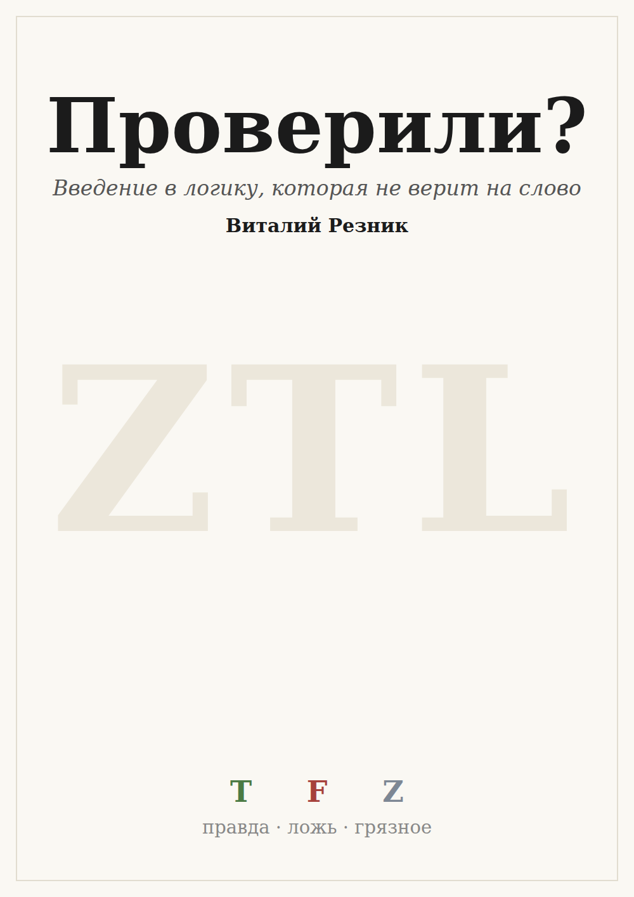

*Начинать можно примерно с шестого-седьмого класса. Верхнего предела нет.*

*И сразу первый пример того, как устроена эта книга: предыдущую строчку мы не
проверяли. Детей мы не спрашивали — это мнение автора.*

---

## О чём эта книга

Петя пишет в чат: «Завтра контрольной не будет!» Это правда?

Может быть. А может, Петя ошибся. А может, учитель передумает к вечеру. Ты
этого не проверял — тебе это **сказали**. И так почти со всем, что мы знаем:
нам сообщили учитель, чат, приложение, одноклассники. Такие сведения мы будем
называть **грязными**: нам их сказали, а мы сами не проверили — и они могут
поменяться.

Обычная школьная логика с грязными сведениями работать не умеет: ей нужно,
чтобы про всё было точно известно «да» или «нет». Эта книга про логику,
которая умеет. Она называется **ZTL** — логика нулевого доверия. Она
рассуждает, когда сведения чужие, и никогда не выдаёт слух за правду.

Девять глав. Первые три — главное: что такое грязное сведение, единственное
правило ZTL и почему у неё ответ всегда «да» или «нет». Дальше — что из этого
следует: что делает слово «не», какие законы логики стоят, а какие падают,
что происходит, когда всё проверено, и чем ZTL отличается от похожих логик.

## Как читать

В конце почти каждой главы есть раздел **«Что тут известно точно»**. Там
отделено то, что доказано или посчитано на компьютере, от того, что мы просто
рассказываем. Если что-то не помечено как доказанное — значит, оно не
доказано.

Где лежат сами доказательства — в приложении в конце книги. Их может проверить
любой: всё лежит в открытом доступе.

## Об авторстве

Логику ZTL разработал Виталий Резник. Эту книгу он задумал и вёл: ставил
задачу, направлял и проверял. Текст под его руководством написал ассистент
Claude (Anthropic); каждую главу перед тем, как считать готовой, читала
отдельная модель Claude глазами семиклассника — понятно ли и интересно ли.
Все примеры с ответами ZTL посчитаны программой, а не на глаз. Участие ИИ
раскрыто здесь прямо — потому что книга как раз про то, чтобы не верить на
слово.
