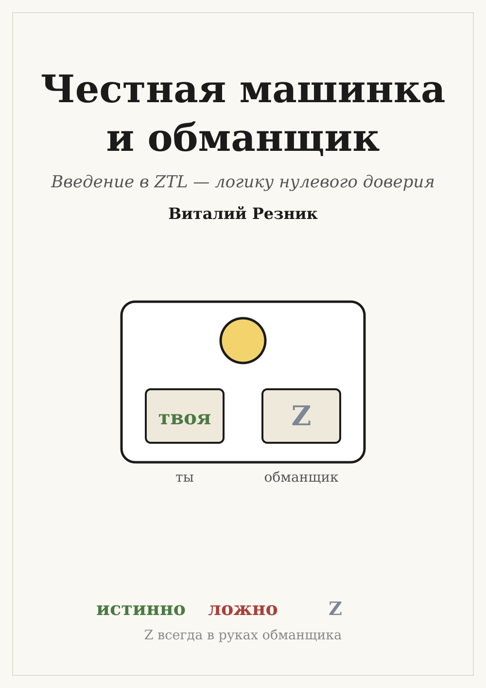

# Введение

---

## Загадка для начала

Есть машинка с двумя коробочками и лампочкой. В каждую коробочку кладут
записку — «да» или «нет». Машинка читает обе и зажигает ответ: ДА или НЕТ.

Одна коробочка твоя, другая — обманщика. Ты хочешь, чтобы лампочка
показала ДА. Обманщик хочет НЕТ. И он хитрый: кладёт свою записку **после**
тебя, когда уже видел твою.

Что положишь ты?

Не спеши. Ответ зависит от того, по каким правилам работает машинка. С
одними правилами обманщика можно обыграть всегда. С другими — никогда. Эта
книга о том, как отличить одно от другого. А на загадку ты ответишь уже
в первой главе.

## Кто такой обманщик

Обманщик в нашей игре — не злодей. Это всё, что **решаешь не ты**: что
напишут в чате класса, что покажет прогноз погоды, что ответит чат-бот, чему
окажется равен x в задаче.

Мы не будем считать, что все вокруг врут. Мы будем честно отличать то, что
знаешь сам, от того, что зависит от других. И смотреть: хватает ли твоего
знания, чтобы ответ был ДА, что бы ни решили другие?

Такой способ рассуждать называется **ZTL** — от английского *zero trust*,
«нулевое доверие». ZTL говорит ДА, только если обманщик бессилен.

## Как читать эту книгу

Главы идут по порядку, и каждая опирается на предыдущие. В начале главы
написано, какие главы нужны.

Сначала — три машинки, на которых обманщика можно победить. Потом мы
научимся записывать игру одной строчкой, узнаем, где обманщик непобедим,
соберём машинки в цепочки, проверим, какие законы логики его выдерживают,
научимся рассуждать и разбирать длинные фразы.

Почти в каждой главе есть раздел **«Проверьте вдвоём»**. Машинка не нужна —
хватит листочков и друга, который согласится побыть обманщиком. Сыграйте:
так понятнее, чем читать.

В конце каждой главы — **задачка**. Сначала подумай сам, потом сверься с
ответами.

Никаких особых знаний не нужно. Только внимание — и немного азарта.

## Об этой книге

**ZTL** — логику нулевого доверия — создал **Виталий Резник**. Он же
придумал игру с честной машинкой и обманщиком, задал порядок глав, читал и
выверял каждую из них.

Текст книги по его замыслу и под его руководством написал искусственный
интеллект Claude (компания Anthropic). Ответы в книге сверены с программой,
которая считает по правилам ZTL.
